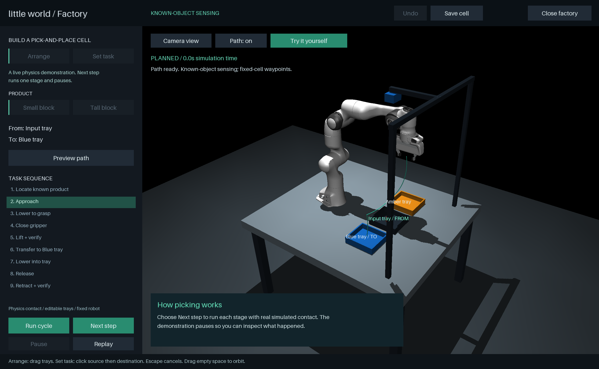
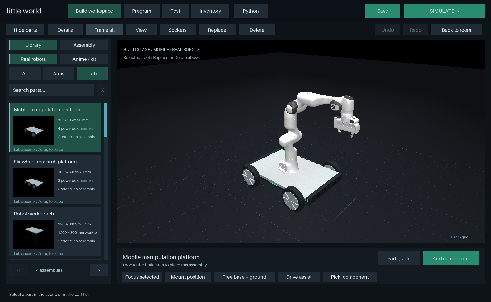
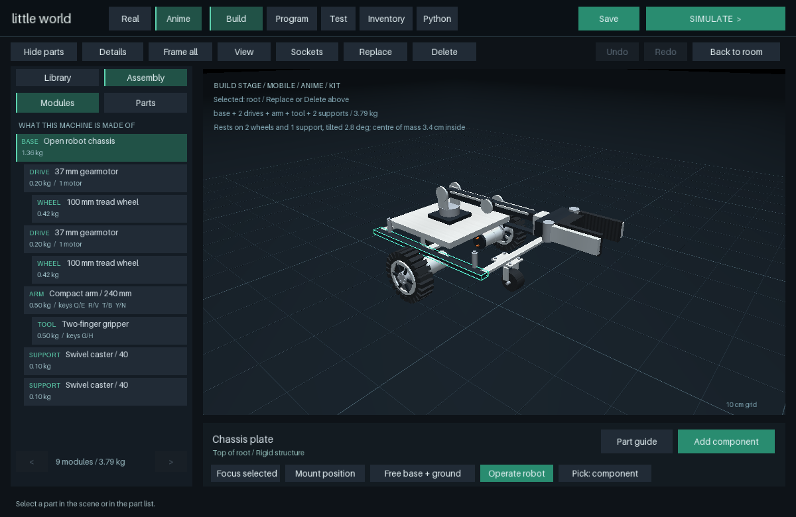
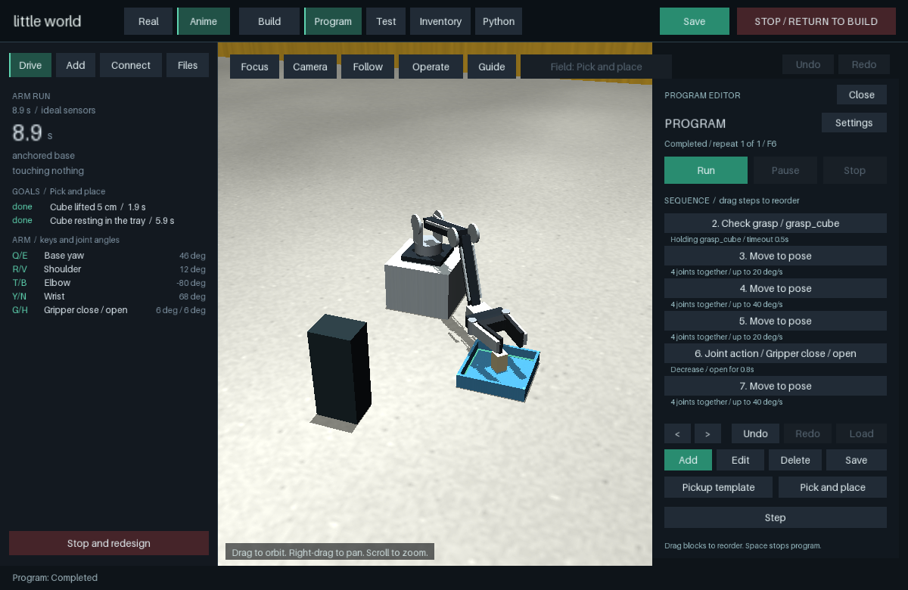
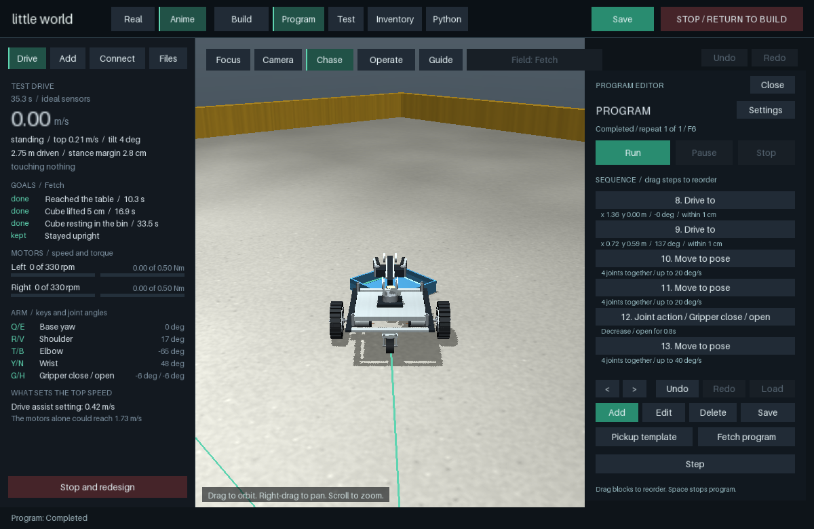
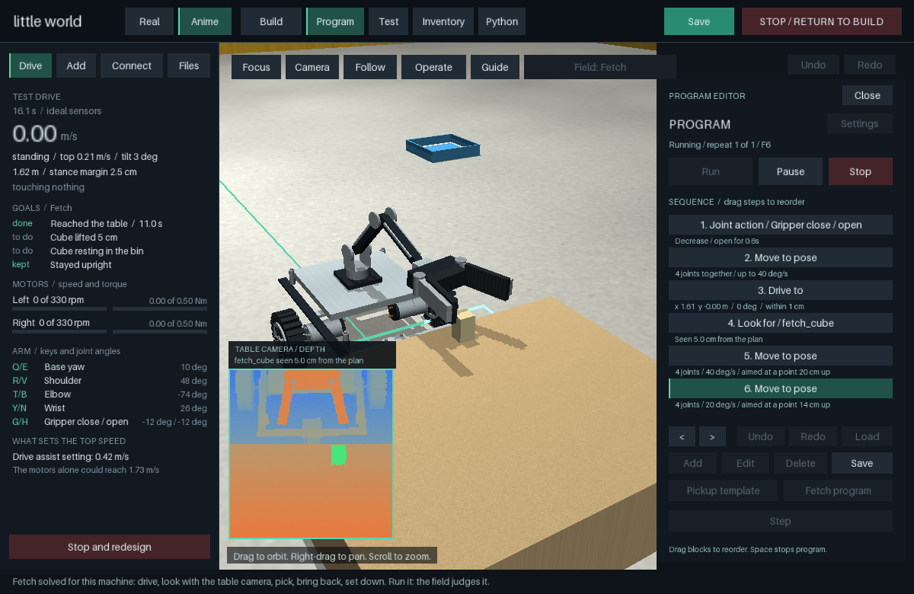
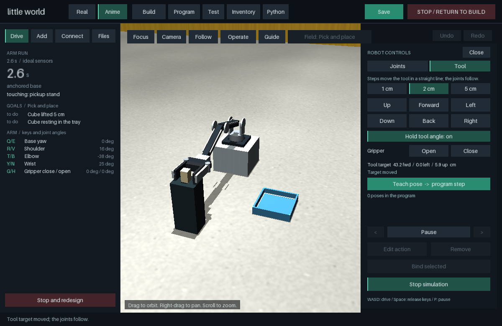

# Little World

**Build a robot from parts, drop it into a room, run the physics, watch it fail,
change the design, try again.** A desktop robotics sandbox on
[MuJoCo](https://github.com/google-deepmind/mujoco), in one native window.

<p align="center">
  
  
</p>

- **Two workflows, one window.** *Real* runs complete robots - UR5e, Franka Panda and
  FR3, Kinova Gen3, from MuJoCo Menagerie with their original meshes, inertias and
  servos. *Anime* is the builder: 85 kit modules (chassis, gearmotors, wheels,
  casters, arms, grippers) and 26 lab assemblies, snapped together on named sockets.
- **Everything is data.** A design is a versioned JSON *Blueprint*. The core is
  standard-library Python and knows nothing about MuJoCo or the UI, so the same
  design can come from the mouse, from the in-app Python builder, or from a script.
- **Build -> simulate -> reset -> redesign**, with undo/redo, face-to-face precision
  connections, joint limits, sourced servo profiles, a block program editor, a live
  test panel (contact, tilt, joint error, torque) and side-by-side trials of saved
  versions. Simulating a vehicle is a **test drive**: a chase camera, live motor and
  slip telemetry, the path on the floor and a run report compared with the last run
  ([ADR 0012](docs/adr/0012-test-drive.md)), in one of ten **test fields** whose
  goals the physics decides: a sprint, a slalom, ramps, curbs, a crate to push, a
  pick-and-place table, a fetch-and-return, a doorway and a tilt table
  ([ADR 0013](docs/adr/0013-test-fields.md)).
- **A pick-and-place cell** where the Panda plans with damped-least-squares IK and
  lifts by real finger contact - a missed grasp is a failure, not an animation. A
  production run places six parts one after another into slots, counting parts placed,
  failures and throughput ([ADR 0019](docs/adr/0019-factory-production-run.md)).
- **Friction from the literature, not from max().** Contact friction is a property
  of a *pair* of surfaces: 26 pairs (rubber on concrete, PTFE on wood, aluminium on
  steel...) with cited kinetic and static coefficients, confidence labels and a
  generated [reference page](docs/CONTACT_PAIRS.md), applied contact by contact
  inside the MuJoCo step ([ADR 0010](docs/adr/0010-sourced-contact-pairs.md)).
- **Motors and wheels lose energy where real ones do.** The kit gearmotor is a Pololu
  37D 30:1 from its datasheet - speed-torque line, plus gearbox friction derived from
  its no-load current - and wheels carry rolling resistance from the load they bear
  ([ADR 0011](docs/adr/0011-drivetrain-and-axle-losses.md)). A bare gearmotor
  runs at the rated 330 rpm; a test cart coasts down within 1 % of the closed form.
- **Arms that hold still on a moving base.** A servo's damping is integrated by the
  solver instead of applied a step late: the mobile manipulator used to chatter at its
  torque limits and creep 12 cm while "standing"
  ([ADR 0014](docs/adr/0014-servo-damping-integrated-implicitly.md)). The build stage
  reads a machine as modules - base, drives, wheels, supports, arm, tool - and predicts
  how it stands before it runs: which parts carry it, its tilt and its stance margin,
  within 0.1 degrees and 1 mm of where the simulator settles
  ([ADR 0015](docs/adr/0015-machine-structure-and-stance.md)).
- **Arms that do a task, judged by the physics.** Move the gripper in straight steps
  instead of joint by joint, teach poses into a program, check grasps, and generate a
  pick-and-place program solved for the arm you built: in the Pick and place field the
  arm lab puts the cube in the tray, and a missed grasp stops the program
  ([ADR 0016](docs/adr/0016-arm-tasks-tool-moves-poses-grasp-checks.md)).
- **A mobile manipulator that fetches by itself.** Programs can drive the base to a
  point and heading; the Fetch program - solved for the machine you built - drives 1.6 m
  to a table, picks up a cube, backs away, drives to a bin and lets go, and the Fetch
  field's goals are all met at 34 s
  ([ADR 0018](docs/adr/0018-fetch-drive-to-a-point.md)). Running it exposed that
  MuJoCo's soft friction let a held cube slide out of the jaws at 2 mm/s; two noslip
  iterations stop that without touching real sliding, which also corrected a curb result
  and freed a Menagerie arm grinding against its own base
  ([ADR 0017](docs/adr/0017-friction-that-holds.md)).
- **How steep before it tips, predicted and then measured.** The build stage predicts the
  slope each side of a machine can take by rocking it, quasi-statically, on a tilted
  floor - a machine that rocks onto a caster has not tipped. On the tilt table, with a
  trip rail set against its wheels, the mobile manipulator goes over at 54 degrees where
  its design says 54.3 (55.8 about the rail's edge); without the rail it slides from 16,
  because only its drive wheels resist a side load. A doorway field checks turning through
  a 50 cm door without touching the frame
  ([ADR 0020](docs/adr/0020-doorway-and-tilt-table.md)). The build stage also warns when a
  design starts in the air, since a run starts it where it was built: the examples used to
  fall 4.3 cm, and landing with the wheels driven left a caster swivelled 37 degrees by the
  second curb ([ADR 0023](docs/adr/0023-machines-start-on-the-floor.md)).
- **Results with their spread.** From a run's report, "Repeat with variations" runs the
  field 20 more times in the background - the machine set down up to 2 cm and 3 degrees off
  its mark, carrying up to 0.5 kg, on surfaces anywhere in their published friction range -
  and shows the spread and what moved it most. The arm on a cart tips between 51.4 and 58.4
  degrees (54.5 as designed); a 3 degree turn on the table moves it most, and with a payload
  aboard the prediction holds within 0.3 degrees. Its Fetch program met every goal in all 20
  runs, and showed a loaded cart rocking between its casters under its own arm
  ([ADR 0024](docs/adr/0024-runs-under-variation.md)) - so a program's arm poses now say
  what point they were aimed at, and where the tool got to is checked and corrected
  ([ADR 0025](docs/adr/0025-poses-aimed-at-a-point.md)).
- **How sure a result is.** A sweep's rates come only from the set-ups drawn at random,
  with an exact 95 % bound: the arm on a cart fetched its cube in 8 of 8 drawn set-ups,
  which shows only that at least 69 % of such set-ups would; drawn 59 times, it fetched it
  in all 59 - it fails in under 5 % of them, with 95 % confidence
  ([ADR 0028](docs/adr/0028-rates-from-runs-drawn-at-random.md)).
- **A tip test done as in a lab.** The tilt table sets a machine square against its rail
  before tilting: one set down turned 3 degrees now tips where it does straight, 54.0
  degrees, instead of 3 degrees early
  ([ADR 0029](docs/adr/0029-tilt-test-squares-the-machine.md)).
- **Shoved mid-task.** A run can be disturbed partway - the machine shoved, a part moved -
  and each set-up compared with itself undisturbed. Shoved once it has stopped at the
  table, the arm on a cart still fetches its cube after a 4 N s shove (about 2 cm) in 9 of
  9 set-ups and after a 6 N s one (about 6 cm) in 3 of 9 - in none with its arm poses run as
  taught; a cube moved 5 cm is never found, since nothing looks for it
  ([ADR 0030](docs/adr/0030-disturbances-during-a-run.md)). "Repeat with disturbances" in a
  run's report runs them in the background. Each set-up is run with and without the
  disturbance, and the two are the same run until it, step for step - so a sweep says how many
  successes the disturbance broke and how sure that is, from the set-ups whose outcome changed
  (an exact McNemar test): without looking again, a cube moved 5 cm after the look broke 8 of
  8 drawn set-ups (p = 0.008); with it, 1 of 59 (p = 1: no effect shown) - in that one the
  jaws came down on the moved cube and, rising off it, dragged it off the table
  ([ADR 0036](docs/adr/0036-paired-runs.md)).
- **Back to its stop.** Pushed more than 2 cm off the stop its program drove it to, a
  machine now drives back - backing off and coming in straight, as it first did - and
  reaches again: shoved 6 N s at the table, the arm on a cart fetches its cube in 8 of 9
  set-ups instead of 3
  ([ADR 0031](docs/adr/0031-going-back-to-the-stop.md)).
- **It looks before it grasps.** The Fetch table has a depth camera on a stand behind it - an
  Intel RealSense D435 with its maker's field of view and depth noise, its pictures cast as
  rays in MuJoCo - and the Fetch program looks for the cube once the cart has stopped: the
  table's plane is removed, what stands on it gathered and the cube's top face fitted, with
  no learned model and no GPU. It finds the cube within 2.4 mm wherever it is set down up to
  8 cm off its plan, and the arm reaches where it was seen: moved 5 cm as the cart stands at
  the table, the cube is fetched in 9 of 9 set-ups instead of none. One set down beyond the
  arm's reach from its stop is seen but not fetched
  ([ADR 0032](docs/adr/0032-a-camera-at-the-table.md)). The program shows the camera's depth
  picture, the cube in green.
- **And looks again.** Just before the jaws go down, the camera takes one more picture; if
  the cube has moved, the jaws go back and the program looks again before touching it - as it
  does when a reach is stopped or the jaws close on nothing. The cube moved 5 cm after the look
  is now fetched in 9 of 9 set-ups instead of none
  ([ADR 0033](docs/adr/0033-looking-again.md)). A reach stopped on the cube first rises off it
  the way it came, instead of dragging it off the table, and a cube whose top the open jaws
  hide is not taken for gone - the picture shows its surface where it was seen: moved 5 cm 2 s
  after the look, the cube is fetched in all 59 drawn set-ups (58 before), and undisturbed none
  looks again for nothing (2 did) ([ADR 0037](docs/adr/0037-rise-first-and-read-the-place.md)).
- **And stops where the cube is.** The camera sees the table from anywhere, so the Fetch
  program looks before it drives and stops where the cube actually is - sideways as far as it
  moved, towards it only as far as the cart stays clear of the table. Set down 15 cm to either
  side or 6 cm further along the table, the cube is fetched (both were missed); 8 cm further
  along, out of the arm's reach from any stop clear of the table, the program stops at the
  table and says so instead of reaching for the wrong place
  ([ADR 0035](docs/adr/0035-the-stop-follows-the-cube.md)).
- **A camera that fails, noticed.** The table camera can freeze on its last picture, or go
  dark, as a disturbance. Each picture carries its frame number and how much of it has depth,
  and a program that gets three in a row that are not new, or have no depth, stops at the look
  and says why - before it moves. Frozen as the cube is moved 5 cm, the program used to grasp
  twice where the stale picture showed the cube; now it stops at the look and says "the
  camera's picture is not new", in all 9 set-ups and in all 59 drawn ones, and every
  undisturbed run is as it was to the millisecond: no false alarm
  ([ADR 0038](docs/adr/0038-a-camera-that-can-fail.md)).
- **How well the camera must be mounted.** The table camera can be set off where the program
  believes it - shifted, panned, tilted - to see how far a hand-set or bumped stand may be off.
  A closed form says how far off the cube is then seen (15 mm sideways per degree of pan at
  the camera's 0.88 m; 13 mm along and 8 mm down per degree of tilt), and shifting the camera
  measures how far off the jaws may be aimed: 10 mm too far or too low, 25 mm to either side,
  more the other ways. Over 59 drawn set-ups each, panned 1.5 degrees, tilted up 0.5 or
  raised 10 mm, every one was fetched (at least 95 %); 10 mm towards the cart, 58 of 59; tilted
  up a degree, 8 of 59 ([ADR 0039](docs/adr/0039-how-well-the-camera-must-be-mounted.md)).
- **How gently, beside whether.** Every run now follows the part it carries: the hardest push
  on it from the machine, the table and the bin (in a step and over 50 ms), how far it leaned
  and how far it fell when let go. The arm on a cart squeezes the cube at about 4.8 N - thirty
  times its weight - and lets it fall about 6 cm into the bin; in 4 of 59 drawn set-ups that met
  every goal, it first pressed the cube into the table. With the cube moved and the program
  blind, a jaw comes down on the cube and presses it into the table at 5 N
  ([ADR 0040](docs/adr/0040-how-gently-a-part-is-handled.md)).
- **A cart that stands on all four.** Those presses came from the cart: its casters stood
  6.5 mm off the floor, so it teetered on its drive wheels, and loaded behind its axle it tipped
  forward as the arm reached over the cube, the jaws coming down on it. Its casters now reach the
  floor its drive wheels stand on: it pitches under 0.2 degrees, and the table only ever carries
  the cube. The price is curbs - unable to pitch, it stalls at one until it has slewed onto a drive
  wheel, over an 18 mm curb at 11.6 s instead of 4.1
  ([ADR 0041](docs/adr/0041-the-cart-stands-on-all-four.md)).
- **Set down, not dropped.** The Fetch program let the cube fall 6.8 cm into the bin: the kit
  arm cannot bring level jaws any lower there without hitting its own cart. Now the jaws close on
  the cube's upper half, squeeze a little harder once they feel it, and over the bin tilt down
  as far as lowers it most - 25 degrees for the kit cart. In all 71 set-ups of a sweep the cube
  falls 3 mm (median; 1.1 cm at most), lands at a quarter of the push it did, and comes to rest
  upright. Each run now also says how far a part leaned before it was held and at rest
  ([ADR 0042](docs/adr/0042-set-down-not-dropped.md)).
- **Does a result survive a micrometre?** A sweep runs each drawn set-up once, so it cannot
  tell a result the design earns from one it happened on. `sweep --jitter 5` runs each again
  five times with the machine set down a micrometre off - the same set-up to any lab - and sets
  each measure's spread under that against its spread across set-ups. The tilt table tips within
  0.05 degrees of itself; Fetch's outcome never changed in 59 set-ups, its times, squeeze and
  lean are the design's, and the set-down is partly chance: the cube's fall into the bin spreads
  0.29 cm under a micrometre against 1.0 cm across set-ups
  ([ADR 0043](docs/adr/0043-the-knife-edge-check.md)).
- **Bring your own robot.** A robot that does not exist yet can be tried: drop its URDF or
  MuJoCo file on the window, or choose *Robot: ... → Import a robot from its file* in the Joint
  lab. Little World copies it into your robot library, adds a position servo to every joint the
  file leaves without a motor - stiff enough to hold the robot within half a degree against its
  own weight, no stronger than the file's effort limit - and says in plain words what it found,
  what it added and what to check (a misspelt attribute, a joint too weak to hold the arm up, a
  mesh MuJoCo cannot read). The robot is then driven from the keyboard, programmed with blocks
  and placed like the Menagerie arms ([ADR 0044](docs/adr/0044-robots-from-their-own-files.md)).
- **The tool travels its line.** In Tool mode a step now carries the tool along a straight line
  at 5 cm/s instead of letting each joint take its own path - a 10 cm step of the kit arm strayed
  up to 12.7 mm from its line, now 0.3 mm - and holding the arrow keys, or Page Up and Page Down,
  drives the tool continuously until it can reach no further. The same for every arm: kit,
  Menagerie or imported ([ADR 0045](docs/adr/0045-the-tool-travels-its-line.md)).
- **The first hour, checked by the app.** The Guide now opens on five short lessons - drive the
  cart through the doorway, bring the gripper to the cube by moving the tool, program the arm to
  lift it, bring in a robot from its file, ask how sure a result is. "Start this lesson" sets up
  the machine and the field; the app watches the work and ticks a lesson off when it is done, in
  any order, saying in a line what is still missing ([ADR 0046](docs/adr/0046-the-first-hour-checked-by-the-app.md)).
- **A gripper from its file.** A robot brought in from its file with a gripper at its end is now
  driven as a gripper: the import finds which joint closes it and which links are its jaws, it is
  driven by how closed it is, 0 to 100 %, and squeezes with its file's effort (12 N at each jaw
  if the file gives none). The grasp blocks and Tool mode's Open and Close work with it as with
  the Panda's: a box it holds, turned over by the elbow, stays within half a millimetre of where
  it was held ([ADR 0047](docs/adr/0047-a-gripper-from-its-file.md)).
- **A radar on the frontier, keyed on its own decisions.** New robotics papers, open
  models, repositories and MuJoCo's own changelog are scored against this project's
  decision records and roadmap and filed under the decision each could change, with the
  words that matched; a triage (adopt, learn, watch, skip) is kept. Its first run found the
  project eleven MuJoCo releases behind, and running the suite on the newest showed which
  three wheel-contact results would move and why
  ([ADR 0021](docs/adr/0021-frontier-radar.md), [radar](docs/RADAR.md)). It reads journals'
  tables of contents too, and its brief feeds a file of numbered proposals - where an
  idea would go in this app, how we would know it worked, what it costs - that the owner
  accepts or declines ([ADR 0026](docs/adr/0026-frontier-brief-and-proposals.md),
  [frontier](docs/agents/FRONTIER.md)). What it and the weekly reading judged stays in the
  repository - 81 papers, releases and engine changes so far, each with its verdict and why -
  and can be searched: `python -m little_world.radar search camera calibration`
  ([ADR 0034](docs/adr/0034-the-radar-keeps-what-it-read.md)).
- **990 automated tests**, including OpenGL window tests that drive the interface
  through its real input callbacks. Every physical claim states its limits
  ([validation](docs/VALIDATION.md)).

## Overview

A compositional macroscopic world simulator. Objects and robots share reusable
parts and a versioned JSON Blueprint. MuJoCo handles initial mechanical physics;
the world representation remains independent of the solver and user interface.

The current interactive workshop lets you select and edit an assembly in a furnished
room, add parts, change materials and motor strength, save a Blueprint, and test it
with MuJoCo. Stop returns to the design so you can modify it and try again.
Thermal physics, fluids, cross-physics coupling and AI remain future work.

## Run

Python 3.11+ and MuJoCo 3.10.0. The app is used on an Intel Mac with Python 3.13; the
test suites run on Linux with Python 3.11. From the repository root on a fresh checkout:

```sh
uv venv --python 3.13 .venv
uv pip install --python .venv/bin/python -e '.[workshop,dev]'
```

Or use `python3 -m venv .venv` and `.venv/bin/python -m pip install -e '.[workshop,dev]'`.
Core-only installation: `pip install -e .` (no MuJoCo dependency).
MuJoCo is pinned to 3.10.0, the newest release with a ready-made wheel for an Intel Mac
(from 3.11.0 on, pip would build MuJoCo from source there), with one contact per convex
pair ([ADR 0027](docs/adr/0027-mujoco-3-10-one-contact-per-convex-pair.md)). An
environment made for 3.3.7 needs the install line above run again.
`requirements-lock.txt` records tested dependencies.

The installed **Little World Builder** app opens in **Real** mode for robot
experiments and programming. Use the top **Real / Anime** switch to move between
the robot lab and custom assembly building in the same window. Each workspace
retains its work and pauses when you leave it.

Open the **interactive workshop** directly in Anime mode (including macOS):

```sh
.venv/bin/python examples/workshop.py
```

The default launch opens the **Robot Workbench** with a hardware mobile base:
open chassis rails, gearmotors, treaded wheels and swivel casters. Browse **Ready to build** or **Advanced**, search by name, inspect the 3D preview, choose an
attachment target and mounting face, then click **Add component**. The centre
viewport shows only your assembly; orbit, pan, zoom and click its components there.
Clicking a subpart also makes it the insertion target; adding a part preserves that
target for repeated assembly operations. **Dimensions** and **Connections** open
the existing precision tools. **Back to room** keeps your design and returns to
simulation. The room's **Build** button reopens it.

`--classic` starts the original simple robot in the room. **Files → Hardware mobile
base** loads the new example; **Robot example** retains the original one. Both are
undoable starting points. The workbench opens inside the same application window.

The room starts in **BUILD**, with physics stopped. The left panel contains the
construction controls, grouped into **Edit**, **Add**, **Connect**, and **Files** tabs. Run/stop,
undo/redo and save remain in the top toolbar:

1. Click a machine part in the scene or the assembly list. Selected parts have a thin outline; their material stays visible.
2. Move in 5 cm increments, rotate around the parent's Z axis, resize, or assign
   metal, wood, rubber or plastic. **Exact dimensions & pose** accepts millimetres
   and XYZ rotations in degrees. Transforms are relative to the parent; moving a root moves
   its attached parts. Resizing a part does not reposition its children.
3. Open **Add** for a 115-entry library, filter by category, and select a part.
   Inspect it in the 3D preview (drag to rotate, scroll to zoom), choose a mounting
   face, and click **Add selected part**. Select a powered wheel in Edit to change
   its torque limit. The **Quick tools** button retains the earlier shortcuts.
   Delete removes a selected part and its descendants.
4. Click **SIMULATE**, then hold WASD to drive compatible powered wheel groups.
   Release to brake. **P** pauses. **STOP / RETURN TO BUILD** restores the saved
   design poses; simulated motion never overwrites the Blueprint. A machine that can
   drive gets a test drive: the camera chases it (drag to look around, scroll to zoom,
   **F** for the room), the **Drive** tab shows its speed, each motor's speed and
   torque against its sourced limits, wheel slip and what it touches, and its path is
   drawn on the floor. A machine with a camera also shows what that camera sees.
5. Stop shows a **run report** - distance, top speed, tilt, time at the motor limit,
   slip, what it touched, and the change from the previous run - with **Redesign in
   Build stage**, **Run again** and, when the drive assist set the top speed,
   **Adjust drive assist**. Use **Undo / Redo**, **Save / Load**, and try again.
6. **Field** (above the room view) chooses where to test: the workshop room, a sprint
   lane, a slalom of bollard gates, 8 / 14 / 20 degree ramps, 10 / 20 / 35 mm curbs,
   a 4 kg crate to push, or a pick-and-place table. Each field's goals are drawn on
   the floor, ticked off live in the Drive tab and listed with times in the run
   report, which compares runs in the same field ([ADR 0013](docs/adr/0013-test-fields.md)).

In **Files**, **Start with block** replaces the design with one ordinary body (undoable). Add a
left wheel, reselect `base`, and add a right wheel to make a motorized assembly.
The initial robot example includes passive supports; your own design may tip or
fail, which is part of the experiment. **Robot example** restores that example.

Save writes `designs/my_machine.json` atomically; Load reads it. Each launch starts
with the example, so use Load to continue a saved design. Choose another file with
`--design path/to/design.json`. Saves contain the assembly Blueprint, not the room
or a simulation checkpoint. Scroll over the part list in Edit to see additional parts.

Mouse drag orbits, right drag pans, and scroll zooms. **Room view / Focus**
change the framing. **F** follows the assembly, **C** toggles the onboard camera,
**Home** restores the close view, and **Enter** switches build/simulate.

### Contact friction

Friction belongs to a pair of surfaces, so each material names the real surface it
stands for (`Material.surface`: rubber, PTFE, aluminium, steel, wood, ABS, HDPE,
concrete) and every contact between two named surfaces uses the sourced coefficient
for that pair - rubber on concrete 0.95 (Xu et al., *Wear* 2025), wood on wood 0.36
(Villar-Garcia et al., *Forests* 2022), PTFE on steel 0.10 (Chemours) and 23 more,
each cited in [CONTACT_PAIRS.md](docs/CONTACT_PAIRS.md). Pairs with no source keep
MuJoCo's own rule (the larger coefficient) and are reported as unsourced. The table
is the fix for a measurable defect: the kit's 0.01 skids used to drag at the floor's
0.8, and the two-wheel robot moved 2 cm in four seconds at 0.2 Nm. With the sourced
skid pair it moved 1.15 m; with its tyres' rolling resistance added (below), 0.36 m.

### Drivetrain and axle losses

Wheels used to have one loss, a viscous damping of 0.01 N m s/rad on every hinge, and
it set everything: the kit gearmotor's bare shaft spun at 477 rpm, the mobile
platform coasted down at 0.33 g and its caster wheels did not turn. Now the kit
gearmotor is the Pololu 37D 30:1 at 12 V: its speed-torque line runs through the
datasheet's stall torque and no-load speed, and its own friction, 0.052 Nm at the
output, comes from the 0.2 A it draws with no load. Wheels roll against b x N, where
N is the load the solver found at the tread that step and b is a published lever arm
(rubber 1.2 mm, a labelled analogue from polyurethane; steel 0.5 mm). The bare
gearmotor now runs at 330 rpm and the platform coasts down at 0.15 g. Tyres are rigid,
rotor inertia is not published and not modelled, and loose rolling bodies (a ball)
have no rolling resistance yet - see [ADR 0011](docs/adr/0011-drivetrain-and-axle-losses.md)
and [validation](docs/VALIDATION.md).

Catalog insertion uses preset mounting positions; **Connect** resolves precise
face-to-face alignment afterward. Free placement gizmos, closed-loop mechanisms,
editing room furniture, and general controller assignment are not implemented yet.
Materials affect density, contact friction (see *Contact friction* above) and surface appearance. Wood uses CC0
image textures; metal, rubber and plastic use procedural surface textures with
approximate specular response. No thermal, chemical, deformation or calibrated
PBR behavior is implied. See [workshop decision](docs/adr/0002-workshop.md).

### Real robot: Franka Panda

Select **Real**, then use the **Robot** picker. The **Franka Panda + gripper**
card includes the seven-axis arm and gripper. FR3, Kinova Gen3 and UR5e are also
available as sourced arm-only models. Drag it
into the build area or click **Add component** for an anchored arm. Click
**Arm controls**, then **Start simulation**. Default joint pairs are Q/E, R/V,
T/B, Y/N, U/J, I/K, O/L; G/H closes/opens the gripper. Release a key to hold the
target. Bindings and movement speeds can be edited. Program Move blocks use degrees
for arm joints and 0–100 percent closed for this gripper.

To mount the arm on a cart, select the cart's deck, click **Mount position**,
choose **Top**, then click **Add component**. The arm model adds 17.45 kg: small kit bases may
tip or struggle to drive. Compatibility here means a simulated rigid mounting,
not verified real-world mounting hardware.

This is the Apache-2.0 Menagerie Panda model, with original visual/collision meshes,
link inertias, joint ranges, position actuator gains and force caps, and the original
tendon/equality-coupled gripper. Its starting pose and servo targets reset together.
It is a complete fixed-size model; its internal links cannot yet be replaced or
resized in the builder. Whole assemblies support mounting, placement, duplication,
removal, JSON save/load and undo. There is no VLA integration or physical calibration
claim. Upstream revision, hashes and license are bundled under
`src/little_world/assets/robots/panda/` and documented in THIRD_PARTY.md.

### Real and Anime workspaces

The top-level **Real / Anime** switch changes workflow in the same native window.
Real focuses on complete robots, experiments and programming. Its Robot picker
contains Panda, FR3, Kinova Gen3 and UR5e. Use Joint lab for operation/programs;
Panda also supports the editable pick-and-place experiment. Anime keeps custom
component construction, generic equipment, inventory and Python tooling.
Switching preserves each workspace and pauses the one you leave. Desktop launch
opens Real by default; `--mode Anime` opens the builder. There are no nested style
tabs in the component library and no separate Factory process.

Drag a part into the workspace to see its full-size 3D geometry, including real
robot meshes. The preview follows the cursor on the ground or snaps to compatible
mounts; green indicates an accepted placement and red an unavailable mount.
Release places it at the displayed pose. Free-standing catalog bases and arms can
also be dragged again after placement. Escape cancels without modifying the design;
a drop creates one undo revision. Preview geometry is temporary and is never stepped
as part of the running simulation. Mount compatibility is not a collision-free or
real hardware fit guarantee.

### Laboratory equipment

The generic equipment collection includes mobile platforms, workbenches, a pedestal, rotary
indexing table, passive roller conveyor, bins, pallet, payload, V-block fixture,
camera gantry, and complete Panda mobile/tabletop workcells. All have model
previews and purpose guides. These are generic assemblies with estimated limits;
the Panda subassemblies retain their sourced models. See [equipment and controls](docs/LAB_EQUIPMENT.md).

### Robot component library

**85 kit modules, 26 generic lab assemblies and four sourced robot models** are included. The default **Ready to build** library emphasizes usable assemblies. Ten new modules
include four- and six-wheel rover bases, a delivery base, three arm-and-gripper
assemblies, powered tilting forks, a scoop, a tipping tray and a pan-tilt camera.
Drop complete bases into the build area; attach arms and tools to compatible mounts.
Drive and joint controls are assigned automatically. The procedural assemblies remain
editable down to their individual parts; the Panda is a complete fixed-size model.

Bare motors, shafts and fasteners are available under **Advanced**. The hardware collection includes:

- Actuators: 37 mm gearmotor with driven output shaft, servo housing/horn with a
  limited joint, and a 42 mm square motor module.
- Structure: 200/400 mm slotted extrusions and an open chassis with deck standoffs.
- Hardware: motor clamp, pillow bearing block, flanged hub, shaft coupler,
  hex-style standoff and socket screw.
- Motion: open-spoke tread wheel and a caster with independent swivel/rolling axes.

The original 22 structural, motion, sensor and enclosure modules remain available
under **Advanced**. Rings and extrusion slots use separated geometry, so openings
are real voids rather than painted circles. Motors retain editable internal joints
and output attachment frames. Catalog mounting now uses the entire module's initial
geometry envelope. Dimensions are illustrative, not vendor CAD tolerances.

Parts remain editable Body/Hinge/Motor/Camera components after insertion, with
namespaced references and undo support. Enclosures do not simulate electronics;
a tray does not simulate a battery; the bumper is rigid; the support foot is not
a rolling caster. Drive motors are ideal torque actuators, not vendor gearmotor
models. Structural modules are genuine collision geometry, not decorative meshes.

Use a left and right powered wheel on one base for keyboard differential drive.
Other mounting orientations and passive mechanisms can be tested physically but
are not automatically wired into a general controller. Arbitrary CAD/mesh imports,
persistent mating constraints, springs, pistons, and powered grippers remain future work.
See [catalog and surfaces](docs/CATALOG.md) for capability and provenance details.

### Managing assemblies

The workbench's **Assembly** tab shows the body hierarchy. Expand/collapse branches,
search by ID, select a parent, or scroll/page through the list. The **Library** tab
returns to the component catalog. Clicking a tree row selects that exact subpart.

Viewport picking defaults to **component**, selecting the nearest catalog assembly
root instead of individual screws or tread blocks. Toggle **Pick: detail** to work
on those smaller pieces. **Focus selected** (F) frames the selected subtree.

**Duplicate** (Cmd/Ctrl+D) copies the selected part and everything attached to it.
Enter an XYZ offset in millimetres, relative to the parent. The copy preserves
materials, internal joints, motors, cameras and attachment frames with fresh IDs.
Fully contained controller descriptors are copied; controllers spanning outside
that subtree are not. The room still drives the first compatible differential
controller; copying a complete robot does not add automatic multi-robot controls.

**Delete subtree**, **Undo**, and **Redo** are available in the workbench. Each
clone/delete is one undo operation. Cmd/Ctrl+Z undoes; Shift+Cmd/Ctrl+Z redoes.
Duplication does not automatically prevent collisions, so choose an appropriate
offset or adjust placement before simulation.

### Precise connections and joints

1. Select the part to move, then open **Connect**. Choose its parent (type to search),
   its local face and the parent's local face. Set a gap in millimetres and press
   **Snap faces**. This aligns face centres and opposing normals, moving the whole
   selected subtree. Named Blueprint attachment frames also appear in the selectors.
2. Choose **Fixed** or **Hinge**. **Axis, pivot & limits** sets the child-local axis,
   pivot in millimetres, damping in Nm s/rad and angular bounds in degrees. Leave
   bounds empty for unrestricted rotation. The gold line shows the hinge axis.
3. **Add motor** or edit its torque limit. Simulate, then **Pulse - / Pulse +** tests
   the selected motor for 0.5 simulation seconds at 25% of its torque limit. Space,
   pause, focus loss and returning to build cancel the pulse.
4. Use **Exact dimensions & pose** in Edit or Connect for numeric placement,
   rotation and shape dimensions. Click a field and type comma-separated numbers;
   Tab selects the next field, Enter applies, and Esc cancels. Each Apply is one
   undoable edit. Dimensions change the selected body, not its children's offsets.

Snap frames are local to each body: a wheel's local Z is its axle. Curved-surface
frames are tangent points. Snapping is a resolved placement operation, not a
persistent mating constraint, automatic collision check or closed-loop solver.
Changing Fixed removes that part's hinge, motors and dependent controller references;
Undo restores them. See [connection design](docs/adr/0003-precise-connections.md).

### Mechanical drive demo

Open the earlier drive-only room:

```sh
.venv/bin/python examples/two_wheel_robot.py
```

- **Hold W/A/S/D or arrow keys** to drive; release to brake.
- **Space / X**: brake. **P**: pause/resume. **R**: reset.
- **F**: toggle follow camera. **C**: toggle onboard camera.
- **Home**: restore the outside view. **Esc**: close.
- Left mouse drag: orbit; right drag: pan (disables follow); scroll: zoom.

Controls are also displayed inside the window. The view follows the robot by
default. Driving uses bounded wheel-speed feedback with physical braking torque;
release is not an instantaneous stop. Losing focus clears held input. The
inspection window uses MuJoCo rendering with its own GLFW input handlers, so drive
keys cannot toggle the native simulate application's wireframe/debug modes.
No additional dependencies are needed: GLFW ships with the MuJoCo Python dependency.
Older `mjpython` launch commands restart automatically with Python on macOS.
`--seconds 3` provides a bounded viewer smoke run.

Run without a viewer (no graphics context needed unless capturing the camera):

```sh
.venv/bin/python examples/two_wheel_robot.py --headless --seconds 2
.venv/bin/python examples/two_wheel_robot.py --headless --left -.5 --right .5
.venv/bin/python examples/two_wheel_robot.py --headless --camera /tmp/robot.ppm
.venv/bin/python examples/two_wheel_robot.py --headless --save-blueprint /tmp/robot.json
.venv/bin/python examples/two_wheel_robot.py --headless --load-blueprint /tmp/robot.json
```

The drive example expects `left_motor`, `right_motor`, `chassis`, and `camera` IDs;
these are example conventions, not Entity requirements. Capture produces RGB PPM.
Other examples: `examples/empty_room.py` and `examples/sliding_block.py`, run with
Python on macOS as well. They use the same core, adapter and inspection viewer.

## Design and lifecycle

```python
from little_world import Entity, World
from little_world.core.scene import Scene
from little_world.physics.mujoco_backend import MujocoBackend
from little_world.robots.two_wheel import two_wheel_blueprint
from little_world.scenes.room import room_entity

robot = Entity("robot", two_wheel_blueprint())
with World(MujocoBackend(), Scene((room_entity(), robot))) as world:
    world.start()  # BUILD → SIMULATE: compile the immutable design
    state = world.step({"robot/left_motor": .5, "robot/right_motor": .5})
    world.reset()  # restore initial state and return to BUILD
    world.set_scene(Scene((room_entity(), robot)))  # replace designs while stopped
```

The factory creates ordinary Body/Hinge/Motor/Camera components. Box/beam/wheel
helpers return data; there is no special Robot class. Geometry uses full dimensions,
SI units, and Z-up; cylinder dimensions are radius and full length. See
[architecture](docs/ARCHITECTURE.md) for frames, materials, lifecycle and limitations.
Controller descriptors serialize. The workshop recognizes the two-actuator
`differential_torque` descriptor for keyboard driving and `keyboard_position`
for limited joint control; arbitrary controller kinds
are not automatically executed. Task,
Controller, Embodiment and Interaction protocols remain extension seams.

## Verification

```sh
.venv/bin/python -m pytest -q
LITTLE_WORLD_TEST_RENDER=1 .venv/bin/python -m pytest -q
```

Tests cover schema roundtrip, references, cycles, units, lifecycle, solver separation,
fall/contact, driving, turning, reset, repeated assembly, and command validation. Workshop tests also cover edits, undo, adding powered
wheels, motor configuration, save/load, and the build/simulate/return workflow.
Camera and drive-window tests are opt-in because they create OpenGL contexts. Mechanical tests
skip when MuJoCo is not installed; core tests still run. These are regression checks,
not real-world accuracy calibration. See [validation](docs/VALIDATION.md).

The workshop UI uses a Pillow font atlas and batched OpenGL drawing. Pillow is
only part of the `workshop` extra; core and the earlier drive demo do not need it.
For a bounded, real-window responsiveness check, run:

```sh
.venv/bin/python scripts/benchmark_workshop.py
```

Start with [vision](docs/VISION.md), [architecture](docs/ARCHITECTURE.md),
[source matrix](docs/SOURCE_MATRIX.md), [roadmap](docs/ROADMAP.md),
[third-party register](THIRD_PARTY.md), and [development rules](AGENTS.md).


For the more detailed mobile base and focused workbench benchmark:

```sh
.venv/bin/python scripts/benchmark_workshop.py --hardware
```

Hardware realism is currently geometry and rigid mechanics. Motor models use ideal
torque, not winding/gear efficiency or electrical control; the servo uses a limited
hinge, not a position-control driver. Bearings/couplers/fasteners omit compliance,
thread engagement and calibrated friction. See [hardware details](docs/CATALOG.md).


## Arm, gripper and keyboard actions

```sh
.venv/bin/python examples/workshop.py --arm
.venv/bin/python examples/programmed_pickup.py
```

The arm lab opens with a four-axis arm, a two-finger contact gripper and a small
cube on a stand. Click **Start simulation**. Hold **G** for about one second to
close the fingers, then hold **R** briefly to lift; **H** opens and releases.

| Keys | Action |
| --- | --- |
| Q / E | Base yaw |
| R / V | Shoulder up / down |
| T / B | Elbow up / down |
| Y / N | Wrist up / down |
| G / H | Gripper close / open |

Release a joint key to hold its target angle. Space clears held keys; P pauses.
Joint limits and motor torque limits still apply. Stop restores the original design.
The gripper uses frictional contact, so placement, load and approach matter.
These are approximate original mechanical modules, not calibrated vendor hardware.

In BUILD, open **Keyboard**, select a powered component, and choose **Bind selected**.
A housing can bind all motors inside it; selecting a joint body binds its own motor.
Choose an action name, two keys, target speed and position/damping gains. Existing
actions can be selected and edited or removed. Bindings save with the Blueprint
and support undo. Reserved navigation/drive keys and overlapping motor assignments
are rejected. The catalog also includes a separate arm link and powered wrist.

`examples/programmed_pickup.py` demonstrates timed actions in Python with the same
saved controller: `press(key)`, step the world with `step_commands(dt)`, then
`release(key)`. There is no in-app code editor or sequence editor yet. Portable
`KeyboardPositionControl` accepts scalar joint observations; the MuJoCo adapter
adds model bias compensation before clamping commanded motor torque. Each command is
a `Torque` that also carries its damping slope (-kd), which the MuJoCo adapter
integrates implicitly so the damping acts on the speed within the step
([ADR 0014](docs/adr/0014-servo-damping-integrated-implicitly.md)).


## Gripper options and mobile arms

Select a gripper (or one of its parts), then **Configure gripper** in the room,
or **Gripper setup** in the workbench. Choose flat, rounded or narrow contact pads,
then rubber, metal, plastic or wood. The final form sets sliding friction, torque
limit per jaw in Nm, and pad length (20–90 mm). Material presets affect contact
friction, density and appearance. Custom friction belongs to this gripper and does
not change other rubber wheels or pads. The operation is saved and undoable.
Where both touching surfaces have a sourced pair, that pair's coefficient is used
([ADR 0010](docs/adr/0010-sourced-contact-pairs.md)); otherwise MuJoCo's larger-of-two
rule applies. Torque is motor strength, not electrical power or a guaranteed grasp force.

The library includes compact (~244 mm), standard (375 mm) and long (525 mm) arms,
measured from yaw axis to tool mount at full extension. Geometry, pivots, attachment
frames and motor limits scale together. All can be attached to a cart like other
catalog modules. Choose the cart's mounting deck as the target, add the arm on Top,
then attach a gripper to its wrist tool frame through Connections. Use Keyboard to
bind the new joints. The prepared cart example already includes drive and arm keys:

```sh
.venv/bin/python examples/workshop.py --cart-arm
```

Or open **Files → Arm on moving cart**. Start simulation; WASD drives the cart,
Q/E rotates the base, R/V raises/lowers the shoulder, T/B controls the elbow, Y/N
controls the wrist and G/H closes/opens the gripper. The arm and cart form one
dynamic assembly: payload and extended reach affect balance. These remain
illustrative modules, with no calibrated payload rating.

The workbench's **Assembly** tab opens on **Modules**: the cart reads as a base, two
37 mm drives each carrying a tread wheel, two casters, the arm (keys Q/E R/V T/B Y/N)
and its gripper (G/H), each with its mass; click one to select it, or switch to
**Parts** for every body. The Build stage header says how the design will stand -
"Rests on 2 wheels and 1 support, tilted 2.8 deg; centre of mass 3.4 cm inside" for
this cart, whose casters sit 6.5 mm above the tread wheels - and the Drive tab shows
the live stance margin next to the arm's joint angles while it runs
([ADR 0015](docs/adr/0015-machine-structure-and-stance.md)).

<p align="center">
  
</p>

## Sourced motor study (not hardware validated)

```sh
.venv/bin/python examples/workshop.py --motor-study
```

Select a powered joint, open **Connect → Choose motor model**, then choose
ROBOTIS XH430-W210 or XH430-W350 at 12 V. Set an **assumed operating torque cap**.
The default 30% of stall is a modeling assumption, not a continuous-duty rating or
verified safe operating limit. Choose **Ideal motor / remove profile** to return
to the original motor. Profiles and source snapshots save with the Blueprint.

Manufacturer endpoints are 2.5 Nm / 50 rpm for W210 and 3.4 Nm / 30 rpm for W350,
at 12 V. Sources: [W210](https://emanual.robotis.com/docs/en/dxl/x/xh430-w210/),
[W350](https://emanual.robotis.com/docs/en/dxl/x/xh430-w350/), checked 2026-09-14.
The speed-dependent torque envelope is a linear estimate between endpoints; the
backend enforces it for all command paths. Braking remains a capped approximation.
The motor-study arm can droop when its assumed cap cannot support the custom links.
That is a simulation result for these assumptions, not a measured payload rating.

**Applying a motor profile does not replace the housing, mass or mounting geometry.**
Firmware control, backlash, electrical current, temperature and continuous torque
are not modeled. Nothing is marked physically measured yet. A calibrated real kit
requires matched mechanics, sourced mounting interfaces and measured load tests.

**Files → Export parts / assumptions** writes a `.parts.csv` beside the design.
It lists candidate motors, source dates, operating assumptions, unassigned motors
and custom geometry separately. This is a design inventory, not a complete shopping
list: fasteners, electronics, wiring, fabrication details and compatibility remain
unresolved. Read `docs/REAL_PART_VALIDATION.md` for the measurement workflow.


## Build, Program and Test workflow

The same top bar stays visible in every workspace: **Build workspace**, **Program**,
**Test**, **Inventory**, and **Save**. Green action buttons emphasize saving,
starting simulation, running programs, and adding components. Program **Run**,
**Pause**, and **Stop** sit above the sequence; **Step** runs one block.
Switching to **Build workspace** stops and resets an active simulation while
preserving the authored design and program. Inventory pauses simulation.
Secondary editing controls stay below the navigation, with destructive actions
marked separately. All navigation works with mouse clicks, including at 1040×740.


```sh
.venv/bin/python examples/workshop.py --program
```

The Program workspace opens with an editable pickup sequence. Click **Run** or
press **F6**. **Step** executes one complete block and pauses before the next;
**Pause** freezes simulation time; **Stop** removes program input while joint
controllers hold their targets. Space stops the program. Return to BUILD resets
physics. Focus loss pauses a running program. Manual drive/joint keys are ignored
while a program owns control. Change the trigger to F7/F8 and set whole-sequence
repeat count in Settings.

Use **Add**, **Edit**, **Delete**, drag rows to reorder, and program-specific
Undo/Redo. Blocks support timed joint actions, left/right wheel-speed targets,
waits, and joint target angles with timeouts. Sensor blocks wait for contact or a
body-centre distance threshold. **If contact** executes the next block when true
and skips it otherwise. **Move to pose** moves several joints together so they arrive
at once (taught from the robot controls), and **Check grasp** fails the program when
the jaws hold nothing, so a missed grasp stops instead of carrying air. This is a
sequential block editor, not an arbitrary graph, nested-loop language. The separate
Python workspace authors designs; conditions use ideal simulation observations; a
timeout fails and pauses instead of silently continuing.

**Pick and place** (next to the pickup template) builds a complete program for the arm
in the **Pick and place** field: close on the cube, check the grasp, lift, carry it over
the tray, lower, open and retract, every waypoint solved for this arm. Run it and the
field judges the result from the physics: the arm lab lifts the cube at 1.9 s and has
it resting in the tray at 5.7 s.

<p align="center">
  
</p>

**Drive to** moves the base's drive axle to a point and heading in the field (ideal
position sensing, no path planning). In the **Fetch** field the same button reads
**Fetch program**: for the mobile manipulator it drives to the table, picks up the cube,
backs away, drives to the bin and lets it go, each stop and arm waypoint solved for the
machine as it stands ([ADR 0018](docs/adr/0018-fetch-drive-to-a-point.md)).

<p align="center">
  
</p>

The Fetch table has a depth camera on a stand behind it, so the program first **looks for
the cube** - here moved 5 cm to the cart's left once the cart had stopped - and brings the
jaws down where it was seen. The corner of the view shows the camera's depth picture: near
warm, far cool, the cube green ([ADR 0032](docs/adr/0032-a-camera-at-the-table.md)).

<p align="center">
  
</p>

Programs are versioned `.program.json` files beside the Blueprint. Main **Save**
saves both; main **Load** reads both (or starts an empty program when no sidecar
exists). Program-panel Save/Load handles the program alone. References are checked
before Run, so deleting a bound motor or sensor body cannot silently retarget a
program. Programs contain data only. A repeat does not reset the robot or props.
The pickup template is prepared for the tabletop lab, not arbitrary cart placement.

**Guide** offers tabletop pickup, mobile pickup and driving-cart starters, plus
contextual suggestions for decks, wrists and driven shafts. Suggested additions
are undoable. Build checks flag absent controls, multiple moving roots and estimated
hardware properties. Suggestions match available attachment frames; they do not
certify physical mounting compatibility. **Build workspace** opens the searchable
catalog and assembly tree; **Program** and **Test** keep the scene visible beside
their controls.

**Test** displays contact, centre distance, bilateral jaw contact, base tilt, joint
target versus actual angle, and applied torque. Use the joint pager for additional
motors. Torque-limited motion is highlighted. A possible-slip indication means
bilateral contact disappeared while the jaw target did not open; this is a heuristic,
not a measured friction coefficient or proof of failure. The 30-degree tilt warning
is also a heuristic. Export the current values with **Export test snapshot**.
Contact work arrays come from the preceding native solve (up to one timestep old).

**Guide → Matched arm families** provides compact, standard and long-reach arm
assemblies with a common mounting deck, matching-size contact grippers and joint
bindings. Three new catalog modules are available independently: arm mounting deck,
compact gripper and wide gripper. These are original procedural families; vendor
interfaces, bearings, fasteners and electronics still require real-world design
and validation. No new family is claimed to be a validated purchasable robot kit.

## Open without a terminal (this Mac)

Double-click **Little World** on the Desktop, or open
`~/Applications/Little World.app`. Drag the app into the Dock for one-click access.
The launcher opens the saved `designs/my_machine.json` and its program when present;
otherwise it opens the pickup lab. Click the Program panel's **Run** button—no
function key is needed. The app launcher uses this checkout's virtual environment,
so keep the checkout at its current path. Startup errors are logged to
`~/Library/Logs/Little World.log`.

## Design inventory and build comparisons

Click **Inventory** in the workshop or workbench. **Save current version** stores
a named snapshot of the complete design and program, with **draft** or **finished**
status and notes. Each save makes a separate version. Search/filter saved designs;
use **Name / status / notes** to update their labels. Finished means you marked it
finished, not that the robot has passed physical validation. Data stays locally in
`designs/inventory` for the default workspace, including across app restarts.

Select a saved version to compare it with the current workspace. **Overview** shows
two 3D previews, estimated total/moving mass, motor counts and automatic strengths
and limitations. Analysis uses the actual primitive dimensions, densities, motor
caps, control coverage and gravity-only torque at the authored starting pose. It
ignores payload, acceleration and supporting contacts when estimating gravity load.
It cannot establish real payload capacity, purchase compatibility or grasp reliability.
**Parts changes** lists additions/removals and saved-to-current parameter values,
including geometry, materials, motor settings and controller changes.

**Performance** runs two independent five-second trials in a background worker:

- **Drive / hold trial:** commanded wheel speed 3 rad/s for two seconds, then stop;
  bound arm joints hold their initial targets. A fixed base only performs the hold.
- **Test current program:** run the exact current program on both designs. Its
  references must exist in both; a program may still be unfinished after five seconds.

Both trials use the same room, props, timestep and solver version. Compare base
displacement, peak joint target error, peak tilt and absolute mechanical work.
Results are simulated observations, not physical measurements or battery estimates.
Metrics are task-dependent; there is no fabricated overall winner score. Results
save with design/program/environment fingerprints. Changed designs, programs, room
or solver versions cannot silently reuse incompatible comparisons.

**Load selected** returns a saved snapshot to the workbench. A different current
workspace is first preserved as a recovery snapshot, including its program. Loading
requires BUILD mode. Merely opening Inventory pauses a running simulation; close
Inventory and explicitly resume when ready. The comparison trials do not alter your
interactive world. Refresh updates the list if another app window saved a design.

## Drag parts onto compatible sockets

In **Build workspace**, drag a library part onto the assembly. Hover a target body
and release on a green named socket. Green means the kit permits that connection;
red means incompatible or occupied. Clicking a red socket explains the refusal.
A translucent preview shows the proposed placement. Existing catalog components
can also be dragged to another socket with their attached descendants; release
commits one undoable change. Escape cancels a drag. Drag empty space to orbit and
right-drag to pan. Precision/custom connections remain in **Connections**.

Wheel insertion makes the containing base mobile and raises it out of the floor.
A left/right **drive module** pair gets WASD control without losing arm key bindings.
**Small free wheel**, **Large free wheel**, and **100 mm tread wheel** are passive:
they roll freely on chassis sockets and become rigidly coupled when docked to a
motor's **output** socket. They do not supply propulsion by themselves. Powered
modules are also visible in the Advanced library.

For older builds, **Free base + ground** releases the anchored root, places the
assembly clear of the floor, and repairs a missing drive binding for a recognized
powered wheel pair. **Anchor base** restores a fixed base. The workbench labels
which mode the assembly uses. Two wheels form one axle; tall or front-heavy robots
may still need fore/aft skids or casters for stability. These are simulator kit
mounting rules, not certification that commercial parts will physically fit.

### Immersive build stage

Build opens on a larger 3D stage with a decorative 10 cm grid. **Hide parts** gives
more room to the robot; **Details** opens the precision inspector and part preview.
**View** offers perspective, front, side and top views; **Frame all** recenters the
assembly. Socket labels appear while dragging, or stay visible with **Sockets**.
The stage and view controls do not change collision geometry or the saved design.

The parts tray now uses illustrated cards: each title has a miniature of its
catalog geometry below it, plus dimensions and powered/passive or joint details.
The entire card, including its picture, is draggable. The part follows the cursor
until a compatible mount previews its installed position. Either wheel side can
be chosen directly by dropping on its green marker or label; passing over an
installed wheel keeps its supporting block available as the target.


### Parts browser and component changes

The Build workspace has an inline **Search parts** field. Results update while
writing and search within the selected library; clear with **X**. The scrollbar can
be dragged, and trackpad/wheel scrolling moves continuously through clipped cards.
Click any illustration to select it, or drag it onto a compatible socket.

Select a component in the scene, then use **Replace** in the top toolbar to choose
another member of its family. Compatible connections and control IDs are retained;
unsupported remounts are rejected. **Delete** removes a leaf component in one edit.
If other components depend on it, review the branch count before removing the
whole branch, or keep it and remove the attached components first. **Undo** restores
the operation. The extra catalog variants include wheel diameters, chassis sizes,
beam lengths, and micro/medium/XL arms; they are procedural models, not calibrated
commercial hardware.


### Mechanical kit: purpose and useful connections

Use **Part guide** beside **Add component** for an illustrated explanation of what
a part does, where it connects, a build example and its simulation limits. Cards
label complete assemblies, individual components and hardware. **Find matching
parts** filters the library to useful companion parts.

Wheel sockets include left/right center and front/rear positions. For a four-wheel
base, use the four front/rear sockets rather than adding wheels around occupied
center sockets. Adjacent wheels need enough clearance; use smaller wheels or a
longer chassis when a mount is blocked. Newly mounted wheels orient their outer
faces automatically, and all left/right motor pairs receive WASD/Program drive.
Existing saved wheel poses are retained; drag a wheel to its socket to remount it.

For a mechanism built from components: attach a **37 mm gearmotor**, select it,
then drag a **crank**, **drive roller**, **flywheel**, **spool**, **rotating plate**,
**passive wheel**, **hub** or **coupler** onto **output**. The builder locates the
moving shaft inside the motor. Loads move with that shaft, without an extra free
joint. Hubs and couplers also expose an output for a subsequent load. Spools are
rotating rigid shapes; cable winding is not simulated.

Design references and implementation boundaries are recorded in
[Mechanical kit research](docs/MECHANICAL_KIT_RESEARCH.md).

### Free wheel placement and drive assistance

Named wheel sockets are starting points. Select an installed wheel and choose
**Mount position** to set any longitudinal coordinate along its chassis, in mm.
Choose a wheel in the catalog first to add one at a specified coordinate. There is
no fixed wheel-count limit. The adjustable extra clearance defaults to 5 mm and can
be reduced to zero; overlapping tires and centers beyond the frame are rejected.
Full XYZ/rotation editing remains in the precision Details workspace.

**Drive assist** offers Gentle, Balanced, Responsive and Custom settings. WASD
commands the two sides; the computer drives every registered motor, including
unequal motor counts. Settings control speed, acceleration, torque fraction,
feedback gain and an optional overspeed limiter. Passive wheels receive no torque
unless connected to a motor output. Mount a gearmotor on each chassis side and
attach a passive wheel to each output to create this alternative drivetrain.
The assistance is a simple robotics controller, not an automotive ECU or a
calibrated traction-control model. Tank belts/caterpillar tracks are not simulated.

All arm sizes now receive defaults on insertion: **Q/E** yaw, **R/V** shoulder,
**T/B** elbow and **Y/N** wrist; grippers use **G/H**. Servos and wrist turntables
also get defaults. Additional modules receive unused key pairs; inspect and change
these in **Keyboard**. Release holds the target position with bounded torque and
gravity compensation. Existing saved designs retain their existing controls.

### Python builder inside the app

Choose **Python** in the top navigation. The editor includes templates, typing,
line navigation, indentation, copy/paste, code undo, **Save script**, **Run build**,
**Cancel build** and **View build**. Cmd/Ctrl+Enter runs; Cmd/Ctrl+S saves.
A successful run applies one undoable design change; syntax errors, invalid models
and the eight-second timeout leave the previous robot intact. Scripts run as local
Python in a worker process, not a security sandbox. Saved JSON never executes code.

```python
from little_world.scripting import RobotBuilder

robot = RobotBuilder.chassis(length=0.65, width=0.28, height=0.04)
for side in ("Left", "Right"):
    for x in (-0.21, 0, 0.21):
        robot.wheel("drive_100", side=side, x=x, clearance=0.005)
robot.drive(max_speed=0.5, acceleration=0.7, torque_fraction=0.8)
blueprint = robot.blueprint
```

Python uses metres and seconds. Assign the finished `Blueprint` to `blueprint`.
`current` contains the starting design, so scripts may also use `AssemblyEditor`
and all existing construction APIs to edit it. Scripts save next to the design as
`.build.py` files; robot JSON and visual sequence programs remain separate files.

### Easier manual robot operation

Click **Operate robot** in Build (including mobile manipulators), or **Operate**
in the room toolbar. Each joint has **− / +** buttons and its current position.
Choose **1°, 5° or 15°** increments. The first click starts simulation automatically.
Panda's **Open / Close** buttons remain visible across pages and change closure by
10% per click; keyboard bindings still work. With multiple grippers, click the
gripper selector to cycle between them. **Pause / Resume** freezes/continues the
scene; **Stop simulation** restores the saved design. Manual clicks stop an active
program.

Switch the panel from **Joints** to **Tool** to move the gripper instead of single
joints: **Up / Down / Forward / Back / Left / Right** in 1, 2 or 5 cm steps along the
arm's own forward and left, with the tool held at its angle (**Hold tool angle**). Each
step is solved for the arm's joints by damped least squares and handed to the servos,
so contact and torque limits still apply; a step out of reach changes nothing and says
how far short it is. **Teach pose** adds where the arm is as a program step
([ADR 0016](docs/adr/0016-arm-tasks-tool-moves-poses-grasp-checks.md)). Registered
robot models keep joint-level control here; the Panda's own planner is in the factory
cell.

<p align="center">
  
</p>

### Automated Factory starter cell

Select **Real**, then **Pick and place** with Panda. Choose a block and output bin, preview the
path, then run the complete pick-and-place task or execute one stage at a time.
The Panda computes joint targets automatically and grasps through physical finger
contact. An overhead camera view is available. This first cell uses explicitly
labeled **known-object sensing**, not image recognition. Drag trays in **Arrange**, then click source and destination in **Set task**.
**How picking works** explains a real cycle one stage at a time. Save cell and Undo
preserve your layout and recipe. **Run 6 parts** runs the cell as a production run:
the input tray's part, then five from a stock shelf fed onto the input tray one by one,
each into its own slot of the destination tray, with parts placed, failures, seconds
per part and parts per minute counted (the feeder is a teleport, not a mechanism). In the
**Joint lab**, **Tool** mode moves a robot's hand in straight steps. Robot and camera
remain fixed; conveyors and arbitrary production lines are future work. The experiment
shares the app window with Anime and retains the separate robot build when you switch
modes. See [Factory](docs/FACTORY.md).


## License

No open-source licence has been chosen for Little World's own code: it is published
here to be read, and all rights are reserved by the author. Bundled third-party
assets keep their own licences - the four MuJoCo Menagerie robot models are
Apache-2.0 or BSD-3-Clause (each directory carries its upstream `LICENSE`), and the
two wood textures are CC0. Details and exact revisions are in
[THIRD_PARTY.md](THIRD_PARTY.md).
