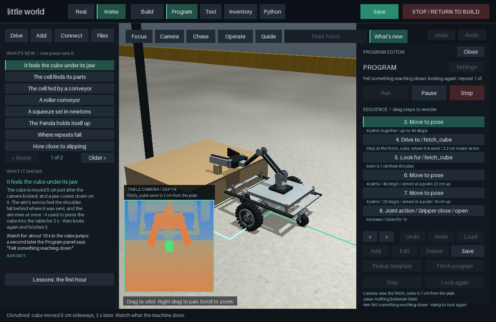

# Little World

**Build a robot from parts, drop it into a room, run the physics, watch it fail,
change the design, try again.** A desktop robotics sandbox on
[MuJoCo](https://github.com/google-deepmind/mujoco), in one native window - and a record
of every decision in it, each with the number it was measured by.

[](https://github.com/Haiming5Chen/Tiny-room/actions/workflows/quick.yml)

<p align="center">
  
  
</p>

## Try it in three commands

Python 3.11 or newer, on macOS, Linux or Windows.

```sh
git clone https://github.com/Haiming5Chen/Tiny-room.git && cd Tiny-room
python3 -m venv .venv && .venv/bin/python -m pip install -e '.[workshop]'
.venv/bin/little-world
```

On Windows the last two are `py -m venv .venv`, `.venv\Scripts\python -m pip install -e ".[workshop]"`
and `.venv\Scripts\little-world`. Without a checkout:
`pipx install "little-world[workshop] @ git+https://github.com/Haiming5Chen/Tiny-room"`, then `little-world`.

The window opens with **What's new** on the left. Press any line and a machine runs that
demonstration: a cart with an arm drives to a table, finds a cube with its depth camera,
feels a cube that was moved under its jaw, looks again and fetches it.

Did it install? `little-world doctor` checks Python, MuJoCo, the assets, a second of physics and
an OpenGL window, and for anything missing prints the one line that mends it. More in
[docs/TROUBLESHOOTING.md](docs/TROUBLESHOOTING.md).

## The first ten minutes

| Do this | And you see |
| --- | --- |
| `little-world`, press **It feels the cube under its jaw** | the Fetch program run with a disturbance; the Program panel says what the camera saw, what the jaws hold and how far the arm is from where it was sent |
| in the Guide, **Lessons: the first hour** | five lessons - drive, move the tool, write a program, import a robot, run a sweep - each ticked off by the app when you have done it |
| `little-world build` | the builder: 85 kit modules snapped together on named sockets; **SIMULATE** drives what you built, **STOP** returns to the design |
| `little-world --real` | complete robots (UR5e, Franka Panda and FR3, Kinova Gen3) and a pick-and-place cell fed by a conveyor and found by a camera |
| `little-world demo --list` | every demonstration by name; `little-world demo felt` starts one directly |

## What is in it

- **A builder and a design format.** A design is a versioned JSON *Blueprint*; the core is
  standard-library Python that knows nothing of MuJoCo or the window, so a design can come from
  the mouse, the in-app Python builder or a script.
- **Eleven test fields whose goals the physics decides** - a sprint, ramps, curbs, a crate, a
  doorway, a tilt table, a fetch-and-return, a roller conveyor - with a run report after each.
- **Block programs that look, feel and recover.** A depth camera finds parts with a real
  sensor's noise; the grasp and the reach are read from servo registers, not from the
  simulator's contacts; a program that finds the world changed looks again.
- **Sweeps that try to break a design** - varied set-ups, disturbances, paired runs, held-out
  draws - and say where the runs failed. Every run checks that no contact gave back more energy
  than it took: the engine's own mistakes are flagged, not believed.
- **Parts with sources.** Gearmotor and servo limits come from datasheets, robot models from
  MuJoCo Menagerie with their licences, and your own robot from its URDF or MJCF file.

All of it, with the decision behind each piece, is in [docs/FEATURES.md](docs/FEATURES.md); how
the window is used is in [docs/MANUAL.md](docs/MANUAL.md); the design is in
[docs/ARCHITECTURE.md](docs/ARCHITECTURE.md) and the 73 decision records in [docs/adr/](docs/adr/).

## Is it right? Check it yourself

This is a simulation, and nothing in it has been checked against hardware. What it claims, it
claims with numbers, and you can measure them again:

```sh
little-world evidence                    # thirteen headline claims, here against recorded: 4 min
little-world evidence --quick            # the six that take seconds
python -m pip install -e '.[workshop,dev]'
python -m pytest -q -m "not slow"        # the quick tier: about 1,000 tests in a minute or two
python -m pytest -q                      # everything without a window: about 25 min on two cores
```

- [docs/EVIDENCE.md](docs/EVIDENCE.md) - each claim, the number recorded for it, the decision
  record that explains it and the test that holds it. One of them is a flaw, kept in the list.
- [docs/EVALUATION.md](docs/EVALUATION.md) - an evaluation of the whole project: what holds,
  what does not, and where it went wrong on the way. Read it before trusting a number.
- [docs/VALIDATION.md](docs/VALIDATION.md) - what each change was checked with, and what it
  does not claim; [docs/agents/OPEN.md](docs/agents/OPEN.md) - what is known to be unfinished.

If a number differs on your machine, that is worth an issue - with `little-world evidence --json`'s
file attached. Finding where it is wrong is what this project is for.

## Where things are

| Where | What |
| --- | --- |
| `src/little_world/` | the package: `core` and `construction` (standard library only), `physics` (the one MuJoCo adapter), `control`, `fields`, `perception`, `programming`, `factory`, `inventory` (sweeps), `ui` |
| `tests/` | one file per area; `tests/slow.txt` lists what the quick tier leaves out |
| `docs/` | [FEATURES](docs/FEATURES.md), [MANUAL](docs/MANUAL.md), [EVIDENCE](docs/EVIDENCE.md), [EVALUATION](docs/EVALUATION.md), [ARCHITECTURE](docs/ARCHITECTURE.md), [VALIDATION](docs/VALIDATION.md), [ROADMAP](docs/ROADMAP.md), the decision records in `adr/`, sweep reports in `sweeps/` |
| `examples/` | small scripts: a sliding block, a two-wheel robot, a programmed pickup |
| `AGENTS.md`, `docs/agents/` | how the people and AI agents who work on this keep their record: reports, open items, the shared log |

## Platforms

Every number in the documents was measured on Linux with MuJoCo 3.10.0, which `pip` installs for
you; the window is used on an Intel Mac. MuJoCo 3.10.0 also has wheels for Apple silicon and
Windows, where this has not been run yet: `little-world doctor` and `little-world evidence` will
say how it does there. A different MuJoCo release runs but moves physics results
([ADR 0027](docs/adr/0027-mujoco-3-10-one-contact-per-convex-pair.md)).

## License

No open-source licence has been chosen for Little World's own code: it is published
here to be read, and all rights are reserved by the author. Bundled third-party
assets keep their own licences - the four MuJoCo Menagerie robot models are
Apache-2.0 or BSD-3-Clause (each directory carries its upstream `LICENSE`), and the
two wood textures are CC0. Details and exact revisions are in
[THIRD_PARTY.md](THIRD_PARTY.md).
