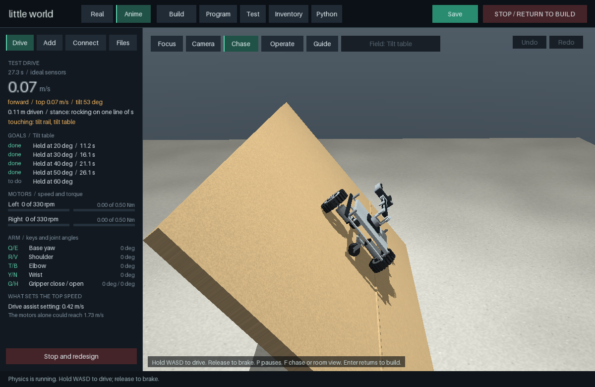
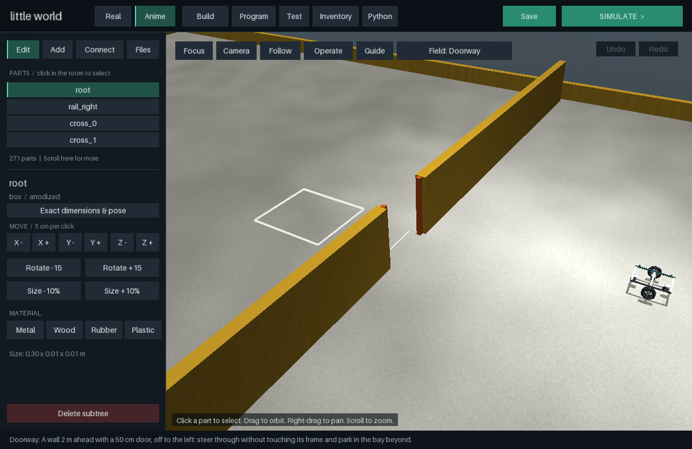

# Doorway and tilt table: turning where it matters, and where a machine tips

**Problem.** Every test field asked machines to go straight - a lane, a slope, a curb, a
crate - so nothing tested turning where turning matters, and ADR 0015's stance, predicted
from the design, was checked only standing still on the level. Two questions a lab asks of
a wheeled machine went unasked: can it get through a door, and how steep a side slope can
it stand on? Asking them showed three defects: the stance's tip angles were wrong for any
machine that rocks onto a caster; a base told to drive to a point a few centimetres to its
side circled it; and the first tilt table measured a slide, not a tip.

**Does an existing simulator solve it? Can we wrap it?** The physics is MuJoCo's: a door
frame is two light posts that fall when hit, and a tilt table is a hinged plate turned by a
motor, as a vehicle tilt table is (a stiff servo whose damping the solver integrates, ADR
0014). What is ours is the field, its goals, and the prediction it checks.

**Unique contribution.**
- *Doorway.* A wall 2 m ahead with a 50 cm door, 50 cm to the left: steer through without
  touching the frame and park in the bay beyond. The posts stand 5 mm clear of the wall, so
  only the machine can move them; "Door frame untouched" fails if one moves 1 cm or leans
  5 degrees. A three-stop program (`goto` blocks, ADR 0018) takes the mobile platform through.
- *Near the goal.* Within 8 cm, a differential base that keeps turning towards a point
  beside it circles that point. It now drives along its heading, forward or back, and
  accepts a sideways error up to three times the tolerance: a non-holonomic base cannot
  close it without backing away and coming in again.
- *Tilt table.* The machine stands on a plywood table that turns about its centre line,
  left side up, 2 degrees per second to 60. Goals: held at 20, 30, 40, 50 and 60 degrees;
  once the machine has leant 25 degrees off the table, the rest are missed with the angle
  it went over at. A field can now move (`Field.actuate`, the table's motor, stepped beside
  the machine's) and be fitted to the machine (`Field.fitted`): the table's 5 mm trip rail
  is set 2 mm outside whatever the machine has lowest on its right, as a vehicle tilt table
  sets its trip rail against the tyres.
- *Tipping, predicted.* `Stance.tips` was atan(reach / height) about the polygon the machine
  rests on. A machine resting on its wheels and one caster only rocks onto its other caster
  when tilted, so that said the mobile platform tips on a 3 degree ramp. Tip angles now come
  from the same quasi-static rocking as the stance itself, on a tilted floor: gravity leans
  off the floor's normal, the machine rocks about its downhill edge until another point
  catches it, and the tip angle is the smallest slope, found by bisection, at which nothing
  does. The build workspace reads "tips on a 54 deg side slope, 51 deg end on".
- *A static test looks like one.* The drive panel's speed, distance, motors and top-speed
  sections say nothing on a tilt table, and its report counted the fall as distance driven.
  A field with a `reading` (the table's angle) is now shown as a static test: the angle on a
  gauge with a tick at the design's predicted tipping angle and one where the machine went
  over, how far the machine leans off the table, and the goals as a row of angle chips. The
  report leads with the result ("Tipped over at 54 deg"), the prediction beside it and the
  difference; the table counts as ground, so standing on it is not reported as touching.
  The Doorway field has a program template, like Fetch: line up, drive through, park.

**Blueprint and builder.** Nothing saved changes. Fields without a machine-fitted part
build as before; a field's motor is the field's, not the machine's.

**Result** (tests/test_more_fields.py):
- The mobile platform's doorway program completes: through, parked, frame untouched, upright.
- A four-wheel skid-steer rover turns under 15 degrees in 3 s on concrete while the mobile
  platform turns over 90: its 1 N m wheels give 10.1 N m of turning moment, and scrubbing
  its tyres sideways takes about 31. A rover cannot turn on the spot here, and the doorway
  says so rather than hiding it.
- Tip angles: a box's are exactly its static stability factor's; two wheels and a caster at
  each end, 1 cm of margin behind the axle, tip over past 55 degrees either way, not at 6.
  The mobile manipulator: 54.3 degrees to either side, 61.4 forward, 50.7 back (was 19.1 -
  the rocking onto its back caster). The platform: 70.1 to the side, 66.2 forward, 60.4 back
  (were 3.2 and 4.7).
- On the table, the manipulator goes over at 54 degrees: predicted 54.3 about its wheels'
  edge, 55.8 about the trip rail's top edge, which is where it pivots. The rest is a caster:
  loaded and pushed sideways, one swivelled 86 degrees as the table rose and moved its
  wheel's contact, which a rigid prediction does not know. The platform holds to 60.
- Without the trip rail against it, the first table measured something else: the
  manipulator slid from 16 degrees - only its drive wheels resist a sideways load, the
  swivel casters roll - crossed 0.4 m of plywood and flipped over a rail at the table's edge
  at 30 degrees. That is also true, and is the reason the rail now sits at the wheels.

**Boundaries.** One table axis: side slopes only; ends are predicted, not measured. The
table's rate is slow enough to be quasi-static for these machines, not for tall ones. The
prediction is rigid: casters, tyres and joint compliance are not in it, which is worth
about 2 degrees here. The doorway checks the frame and the goals, not a planned path: the
stops are given by hand.

